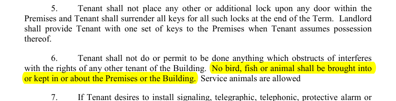
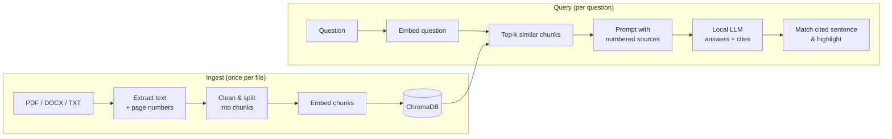

# Local Document Q&A (RAG)

Ask questions about your contracts, leases and other documents in plain English, and get an answer **with a citation to the exact page and sentence it came from**. Everything runs locally: no API keys, and no document ever leaves your machine.

Built from scratch in Python, **without LangChain or LlamaIndex**, to understand every stage of a retrieval-augmented generation (RAG) pipeline.

```
$ python rag/ask.py "When does the lease end?"
The lease ends on the Termination Date, which is the date which is the number of
months after the Rent Commencement Date as set forth as the Lease Term in the
Lease Schedule. [1]

Sources:
[1] sampleleaseagreement.pdf, page 1
```

In the web app, the sentence behind each citation is highlighted on the original page. Here it's the clause found for *"Are pets allowed?"* on page 34 of the lease:



---

## Features

- **Answers with verifiable citations**: every claim is tagged with a numbered source (`[1]`, `[2]`) that maps to a file and page, or to a section for Word documents.
- **Sentence-level highlighting**: the sentence that supports each citation is found in the source text and highlighted, both in the passage and on the rendered PDF page.
- **Refuses instead of guessing**: if the documents don't contain the answer, it says so instead of falling back on the model's general knowledge.
- **Multiple formats**: text-based PDF, Word (`.docx`, split by headings) and plain text / Markdown.
- **Incremental indexing**: files are fingerprinted with SHA-256. Unchanged files are skipped, and edited, renamed or deleted files are kept in sync with the index.
- **Two interfaces**: a command-line tool and a Streamlit web app with document upload and chat history.
- **Built-in evaluation**: a benchmark that scores retrieval and answer quality separately.

## How it works



1. **Load**: text is extracted page by page (PyMuPDF), or section by section for Word documents, so every piece of text keeps its location. Ligatures, hyphenated line breaks and extra whitespace are cleaned up.
2. **Chunk**: pages are split into ~800-character chunks with 150 characters of overlap by a recursive splitter: paragraphs first, then sentences, then word boundaries for very long sentences.
3. **Embed & store**: chunks are embedded with `nomic-embed-text` (using its `search_document:` / `search_query:` task prefixes) and stored in ChromaDB with their metadata. Chunk IDs are derived from the file's content hash, so re-indexing is idempotent.
4. **Retrieve**: the question is embedded and the *k* nearest chunks are retrieved by cosine distance.
5. **Generate**: the chunks are numbered and placed in the prompt with strict instructions: answer only from these sources, cite them, and say so if the answer isn't there. The local model (`qwen2.5:3b` by default) runs at temperature 0 with an explicit context window.
6. **Locate the evidence**: for each citation, the answer sentences that cite it are fuzzy-matched (RapidFuzz `token_set_ratio`) against the sentences of that source, and the best match is highlighted. The displayed evidence is always the document's own text, never the model's paraphrase.

## Evaluation

[`rag/evaluate.py`](rag/evaluate.py) runs a fixed question set ([`eval/questions.json`](eval/questions.json)) against a 48-page commercial lease. The questions include ones phrased differently from the document (e.g. *"eminent domain"* vs. *"condemnation"*) and ones the document cannot answer. Retrieval and generation are scored **separately**, so each failure can be traced to the stage that caused it.

| Metric | Result |
|---|---|
| Retrieval hit@5 (right page among top 5) | 15 / 17 |
| Retrieval hit@1 | 13 / 17 |
| Mean reciprocal rank | 0.81 |
| Correct answers | 11 / 17 |
| Correct refusals on unanswerable questions | 3 / 3 |

<sub>Baseline: chunk size 800, overlap 150, k = 5, `nomic-embed-text` + `qwen2.5:3b`.</sub>

Most failures come from the generation step: the right passage was retrieved, but the 3B model was too literal (for example, not treating *"dog"* as covered by *"animal"*). That points to prompt tuning or a larger model as the next improvement, not changes to retrieval.

## Getting started

### Prerequisites
- Python **3.12+**
- [Ollama](https://ollama.com/download) installed and running
- About 3 GB of disk space for the models. A GPU is optional; the default models also run on CPU.

### Installation
```bash
git clone https://github.com/llaacaa/RAG-project
cd RAG-project

python -m venv .venv
# Windows:      .venv\Scripts\activate
# macOS/Linux:  source .venv/bin/activate
pip install -r requirements.txt

ollama pull qwen2.5:3b
ollama pull nomic-embed-text
```

### Usage
Put your documents in `docs/`, then:

```bash
# Index everything in docs/ (re-run any time; unchanged files are skipped)
python rag/ingest.py

# Ask from the command line
python rag/ask.py "When does the lease end?"

# Inspect retrieval only, without calling the LLM (useful for debugging)
python rag/ask.py --retrieve-only -k 8 "What is the security deposit?"

# Web interface (upload documents, chat, view highlighted pages)
streamlit run app.py

# Run the benchmark
python rag/evaluate.py                    # full run
python rag/evaluate.py --retrieval-only   # fast, retrieval metrics only
```

## Configuration

All settings are in [`rag/config.py`](rag/config.py):

| Setting | Default | Notes |
|---|---|---|
| `CHAT_MODEL` | `qwen2.5:3b` | Any Ollama chat model, e.g. `qwen2.5:7b` for better answers |
| `EMBED_MODEL` | `nomic-embed-text` | Changing it requires re-indexing |
| `CHUNK_SIZE` | `800` | Characters per chunk. Requires re-indexing |
| `CHUNK_OVERLAP` | `150` | Characters shared between neighbouring chunks |
| `DOCS_DIR` / `CHROMA_DIR` | `docs/`, `chroma_db/` | Resolved relative to the project root |

> After changing the embedding model or the chunking settings, delete `chroma_db/` and run `python rag/ingest.py` again. File hashes don't change, so ingestion would otherwise skip every file.

## Project structure

```
├── app.py                 Streamlit web interface
├── rag/
│   ├── config.py          Settings (models, chunking, paths)
│   ├── loaders.py         PDF / DOCX / TXT text extraction and cleaning
│   ├── chunker.py         Recursive splitter with overlap
│   ├── embeddings.py      Embeddings via Ollama, with task prefixes
│   ├── store.py           ChromaDB wrapper (add, look up, delete)
│   ├── ingest.py          Incremental, hash-based indexing of docs/
│   ├── retriever.py       Question -> top-k chunks
│   ├── generator.py       Prompt construction and streamed LLM output
│   ├── highlight.py       Fuzzy matching of citations to source sentences
│   ├── ask.py             Command-line interface
│   └── evaluate.py        Benchmark: retrieval and answer metrics
├── eval/
│   ├── questions.json     Benchmark questions with ground-truth pages
│   └── results/           Saved benchmark runs
├── docs/                  Your documents
└── assets/                README images
```

## Design decisions

- **No RAG framework.** Every stage is a small, readable module, so each one can be inspected, tested and tuned on its own.
- **Chunks never cross page boundaries**, so every chunk has exactly one unambiguous page number to cite.
- **Content-hash chunk IDs** (`{sha256}_{chunk_index}`) make indexing idempotent and survive file renames without creating duplicates.
- **Evidence is located by code, not by the model.** Asking a 3B model to quote its sources in a fixed format proved unreliable, so the supporting sentence is found by fuzzy matching against the real document text.
- **PDF pages are rendered in a separate process**, so a malformed PDF can't crash the web app.

## Limitations & roadmap

- **No OCR**: scanned PDFs (images of text) yield no text. Planned: Tesseract-based OCR.
- **Tables** in PDFs are extracted as flat text and lose their structure.
- **Repeated page headers and footers** are not yet removed and add noise to some chunks. Planned: detect lines that repeat across most pages.
- **Retrieval is embedding-only**: exact terms such as clause numbers or dates are better served by keyword search. Planned: hybrid BM25 + vector search with reciprocal rank fusion.
- **Small model trade-off**: the default 3B model is fast (about 7 s per question in the benchmark on a consumer GPU, including retrieval) but sometimes reads its instructions too literally.

## Tech stack

Python · [Ollama](https://ollama.com) · [ChromaDB](https://www.trychroma.com) · [PyMuPDF](https://pymupdf.readthedocs.io) · [python-docx](https://python-docx.readthedocs.io) · [RapidFuzz](https://rapidfuzz.github.io/RapidFuzz/) · [Streamlit](https://streamlit.io) · [Rich](https://rich.readthedocs.io)
